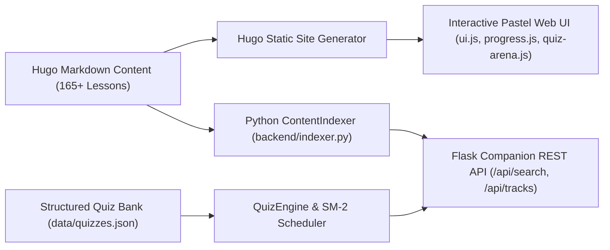

# MiniLearn System Architecture

## 1. Hybrid Static + Companion API Design

## 2. Component Overview

- **`content/`**: 165 structured Markdown lessons spanning **DSA**, **Python**, **C**, **C++**, **Java**, **Go**, **Cheat Sheets**, **Interview Top-75 Roadmap**, and the **Practice Quiz Arena**.
- **`layouts/`**: Custom Hugo header/footer partials and shortcodes (`complexity.html`, `callout.html`, `quiz.html`).
- **`static/css/` & `static/js/`**: Modern pastel theme (`pastel.css`), dark-mode overrides (`custom.css`), reading progress & code-copy controller (`ui.js`), `localStorage` lesson completion & study streak tracker (`progress.js`), and multi-track quiz arena (`quiz-arena.js`).
- **`backend/`**: Python Flask microservice (`app.py`), Markdown frontmatter & inverted search indexer (`indexer.py`), and SuperMemo SM-2 spaced-repetition quiz grading engine (`quiz_engine.py`).
- **`scripts/` & `tests/`**: Automated curriculum validator (`validate_content.py`), static search index generator (`build_search_index.py`), and `unittest` suite (`test_indexer.py`, `test_api_and_quiz.py`).
